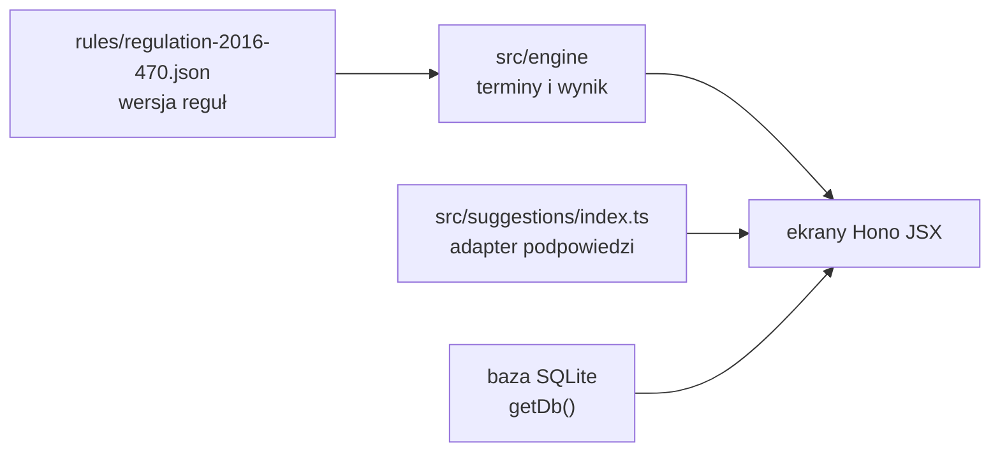

# mOcena

mOcena is a prototype of a digital assistant for periodic assessments in the Polish civil service. It guides the appraiser, the appraised employee and HR through the whole cycle, and it never writes the assessment.

Asystent ocen okresowych to nie AI, które pisze ocenę. Przełożony ocenia dwa lata pracy, a pamięta ostatnie tygodnie. mOcena prowadzi go przez cały cykl i pilnuje faktów, terminów i przepisów, a decyzję zawsze podejmuje człowiek.

**Zobacz na żywo:** https://mocena.pietkiewicz-mikolaj.workers.dev

Kliknij »Rozpocznij pokaz«: 5 kroków, ok. 3 minut. Każdy widz ma własne dane pokazowe.

## Co robi

Pokaz idzie jedną oceną pracownika od początku cyklu do potwierdzenia zapoznania:

1. **Początek cyklu i kryteria.** Stanowisko bez kierowania ludźmi dostaje arkusz C (§ 3 ust. 4 rozporządzenia). Kryteria obowiązkowe pochodzą z arkusza; oceniający wybiera najwyżej 3 kryteria dodatkowe (§ 5 ust. 2). Karta rozmowy rozpoczynającej ma cztery tematy (§ 5 ust. 1). Podpowiedź kryteriów dodatkowych pochodzi z tabeli ustawień urzędu, nie z przepisu, i jest tak oznaczona.
2. **Zmiana zadań.** Przy notatce jest pole „Zmiana zadań pracownika”. Gdy jest zaznaczone, system zadaje jedno pytanie zamknięte; po odpowiedzi „tak” pokazuje kartę rozmowy i formę rozwoju z katalogu urzędu. Próg zmiany stanowiska to art. 81 ust. 6 ustawy. System nie rozstrzyga, czy zmiana jest zmianą stanowiska.
3. **Nieobecność i termin.** Dwie nieobecności rozdzielone tylko dniami wolnymi liczą się jako jedna. Nieobecność dłuższa niż miesiąc przedłuża termin oceny o swój czas (art. 81 ust. 7 ustawy). Okres oceny to 24 miesiące (art. 81 ust. 4 ustawy).
4. **Ocena i wynik.** Średnia nie jest zaokrąglana. Jedna ocena cząstkowa „1” daje wynik negatywny, nawet przy wysokiej średniej (§ 11 ust. 1). Przy ocenie negatywnej uzasadnienie jest obowiązkowe (§ 11 ust. 3). Wnioski do indywidualnego programu rozwoju są zawsze wymagane (art. 81 ust. 5 ustawy).
5. **Zapoznanie i sprzeciw.** Oceniany potwierdza zapoznanie z oceną na własnym koncie. Od tego dnia liczy się 7 dni na sprzeciw (art. 83 ust. 1 ustawy). Stopień służbowy z mocy prawa wymaga działania w 30 dni od zapoznania z drugą oceną (art. 89 ust. 2 ustawy).

## Czego nie robi

- Nie pisze oceny ani zdań o pracowniku. Treść arkusza pochodzi od przełożonego, a uzasadnienie składa się z jego własnych notatek.
- Nie proponuje punktów.
- Nie porównuje pracowników i nie ma rankingów.
- Nie stawia etykiet ani wskaźników przy nazwisku.
- Nic nie zapisuje bez kliknięcia człowieka.
- Nie używa modelu językowego. Kliknięcie to potwierdzenie w systemie. Moc prawną daje dziś wydruk arkusza; urząd może w tym miejscu podłączyć kwalifikowane albo zaufane rozwiązanie elektroniczne.

## Jak działa

- **Reguły w jednym pliku z wersją:** `rules/regulation-2016-470.json` (wersja `2016-470/1`, obowiązuje od 23.04.2016). Każda ocena zapamiętuje wersję, w której powstała. Ustawienia urzędu są w `rules/office-settings.json` i oznaczone osobno.
- **Silnik terminów i wyniku:** `src/engine/`. Czyste funkcje na datach, bez bazy: terminy (`deadlines.ts`), nieobecności (`absences.ts`), średnia i wynik (`scoring.ts`, `approval.ts`), stopnie (`grades.ts`).
- **Adapter podpowiedzi:** `src/suggestions/index.ts` to jedyne wymienne miejsce na podpowiedzi. Dziś działają reguły. Urząd może tu podłączyć model uruchomiony u siebie; model dostaje treść notatki bez nazwisk i nie wykonuje żadnej z czynności zakazanych powyżej.
- **Dane:** jedna baza SQLite, dostęp przez `getDb()`. Pokaz nie wysyła danych do usług zewnętrznych poza wdrożeniem pokazowym. Dane pokazowe są wgrane z góry.



## Uruchomienie lokalne

```sh
bun install
bun run seed
bun run dev
bun test
```

`bun run seed` wgrywa dane pokazowe. `bun run dev` uruchamia serwer z przeładowaniem.

## Wdrożenie

```sh
bun run deploy
```

Skrypt wywołuje `wrangler deploy` na podstawie `wrangler.jsonc`.

## Podstawa prawna

- ustawa z 21 listopada 2008 r. o służbie cywilnej (Dz. U. z 2026 r. poz. 590), art. 81–83, 89 i 108,
- rozporządzenie Prezesa Rady Ministrów z 4 kwietnia 2016 r. w sprawie ocen okresowych (Dz. U. poz. 470).

## Struktura repo

- `src/`: trasy, ekrany, silnik (`src/engine/`), adapter podpowiedzi (`src/suggestions/`), dane pokazowe (`src/seed*`)
- `rules/`: przepisy i ustawienia urzędu w plikach JSON z wersją
- `public/`: style i fonty
- `scripts/`: skrypty pomocnicze
- `context/`: dokumentacja projektu, w tym decyzje, PRD i plany zmian
- `README.md`, `package.json`, `wrangler.jsonc`: opis, skrypty i konfiguracja wdrożenia

Dokumentacja projektu: [decyzje](context/foundation/decisions.md), [PRD](context/foundation/prd.md), [roadmapa](context/foundation/roadmap.md).
