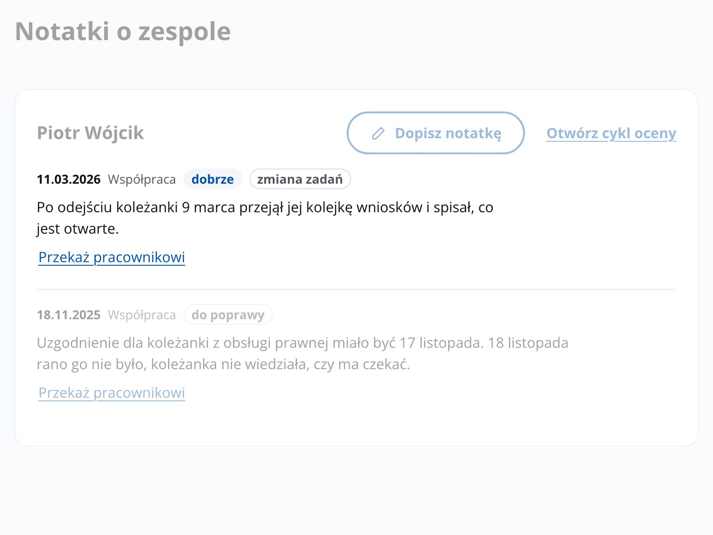
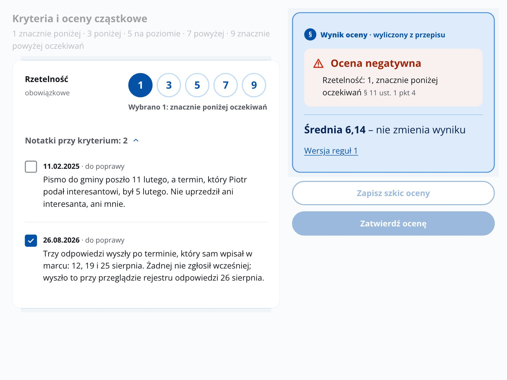
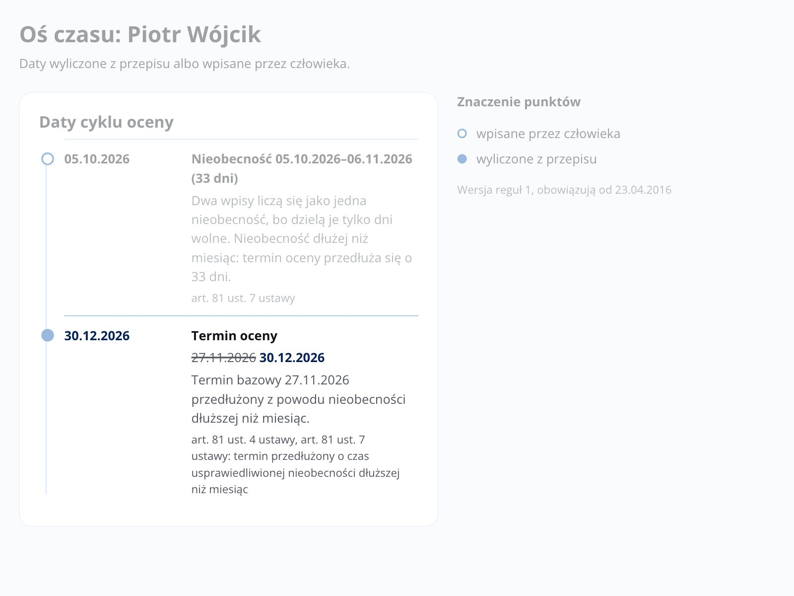
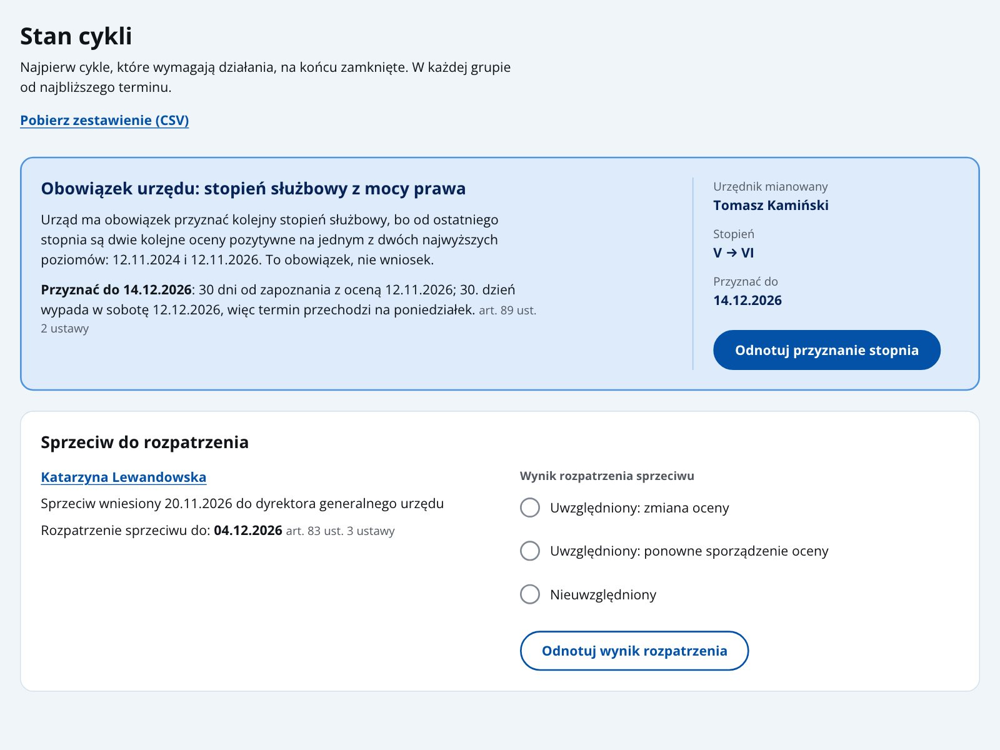
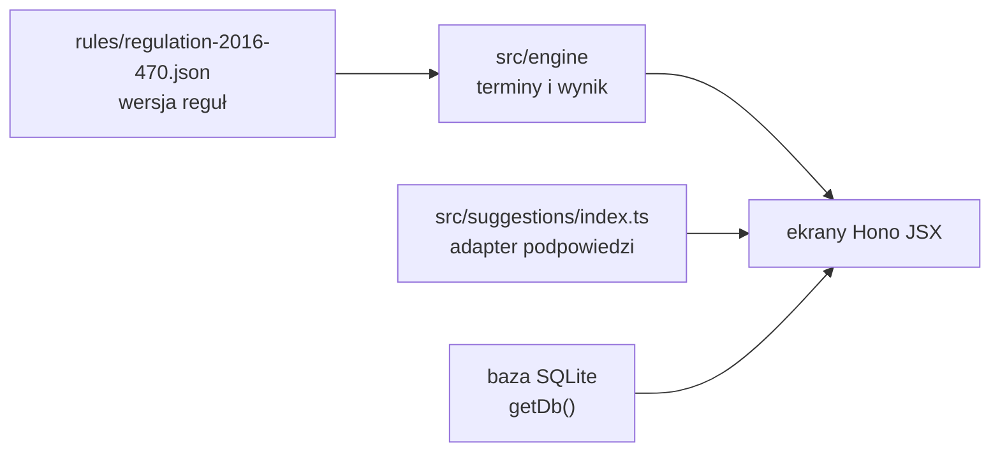

# mOcena

mOcena is a prototype of a digital assistant for periodic assessments in the Polish civil service. It guides the appraiser, the appraised employee and HR through the whole cycle, and it never writes the assessment.

Asystent ocen okresowych to nie AI, które pisze ocenę. Przełożony ocenia dwa lata pracy, a pamięta ostatnie tygodnie. mOcena prowadzi go przez cały cykl i pilnuje faktów, terminów i przepisów, a decyzję zawsze podejmuje człowiek.

**Zobacz na żywo:** https://mocena.mewitz.com

Kliknij „Rozpocznij pokaz”: 5 kroków, ok. 3 minut. Każdy widz ma własne dane pokazowe.

**Film: jak działa (niecałe 2 minuty, bez dźwięku):** https://mocena.mewitz.com/film/

**Prezentacja dla jury (PDF, 15 slajdów):** [`docs/pitch/mocena-prezentacja.pdf`](docs/pitch/mocena-prezentacja.pdf)

## Co robi

Pokaz idzie jedną oceną pracownika od początku cyklu do potwierdzenia zapoznania:

1. **Początek cyklu i kryteria.** Stanowisko bez kierowania ludźmi dostaje arkusz C (§ 3 ust. 4 rozporządzenia). Kryteria obowiązkowe pochodzą z arkusza; oceniający wybiera najwyżej 3 kryteria dodatkowe (§ 5 ust. 2). Karta rozmowy o kryteriach ma cztery tematy (§ 5 ust. 1). Podpowiedź kryteriów dodatkowych pochodzi z tabeli ustawień urzędu, nie z przepisu, i jest tak oznaczona.
2. **Zmiana zadań i strażnik danych wrażliwych.** Przy notatce jest pole „Zmiana zadań pracownika”. Gdy jest zaznaczone, system zadaje jedno pytanie zamknięte; po odpowiedzi „tak” pokazuje kartę rozmowy i formę rozwoju z katalogu urzędu. Próg zmiany stanowiska to art. 81 ust. 6 ustawy. System nie rozstrzyga, czy zmiana jest zmianą stanowiska. Przy zapisie notatki strażnik danych szczególnych z art. 9 RODO na jawnej liście słów urzędu (`sensitiveDataWords`) ostrzega o możliwych danych o zdrowiu, życiu rodzinnym lub wyznaniu i wstrzymuje zapis (`422`) do usunięcia fragmentu albo świadomego potwierdzenia związanego z treścią; system niczego nie usuwa automatycznie.
3. **Nieobecność i termin.** Dwie nieobecności rozdzielone tylko dniami wolnymi liczą się jako jedna. Nieobecność dłuższa niż miesiąc przedłuża termin oceny o swój czas (art. 81 ust. 7 ustawy). Okres oceny to 24 miesiące (art. 81 ust. 4 ustawy).
4. **Przygotowanie, ocena i wynik.** Przed rozmową oceniany może zapisać najważniejsze osiągnięcia oraz tematy i uwagi do rozmowy (`/cycles/:id/self-prep`); widzi je oceniający na ekranie „Przed rozmową z pracownikiem”, bez automatycznego kopiowania do arkusza oceny. Średnia nie jest zaokrąglana. Jedna ocena cząstkowa „1” daje wynik negatywny, nawet przy wysokiej średniej (§ 11 ust. 1). Przy ocenie negatywnej uzasadnienie jest obowiązkowe (§ 11 ust. 3). Wnioski do indywidualnego programu rozwoju zawodowego są zawsze wymagane (art. 81 ust. 5 ustawy).
5. **Zapoznanie i sprzeciw.** Oceniany potwierdza zapoznanie z oceną na własnym koncie. Od tego dnia liczy się 7 dni na sprzeciw (art. 83 ust. 1 ustawy): oceniany może wnieść sprzeciw z uzasadnieniem w aplikacji (`/cycles/:id/objection/new`), a dyrektor generalny urzędu albo kadry rozstrzygają go w ciągu 14 dni (`/cycles/:id/objection`, `/hr` — zmiana oceny, ponowne sporządzenie oceny albo nieuwzględnienie sprzeciwu, art. 83 ust. 3–5 ustawy). Stopień służbowy z mocy prawa wymaga działania w 30 dni od zapoznania z drugą oceną (art. 89 ust. 2 ustawy).

Z 30 czynności z listy organizatora 28 działa, a 2 są uproszczone. Co dokładnie i gdzie to zobaczyć: [`docs/coverage.md`](docs/coverage.md).

## Jak to wygląda






## Czego nie robi

- Nie pisze oceny ani zdań o pracowniku. Treść arkusza pisze przełożony. Do uzasadnienia może wstawić własne notatki z datą.
- Nie proponuje punktów.
- Nie porównuje pracowników i nie ma rankingów.
- Nie stawia etykiet ani wskaźników przy nazwisku.
- Nic nie zapisuje bez kliknięcia człowieka.
- Nie używa modelu językowego.
- Nie obsługuje pierwszej oceny (art. 37–38 ustawy o służbie cywilnej). Dotyczy ona pracownika zatrudnionego na czas określony, ma odrębny tryb i wzór arkusza z innego rozporządzenia niż ocena okresowa; urząd prowadzi ją poza systemem. Pierwszy cykl oceny okresowej po zatrudnieniu na czas nieokreślony jest obsłużony.
- Kliknięcie to potwierdzenie w systemie. Moc prawną daje dziś wydruk z podpisem. Urząd może w tym miejscu podpiąć podpis kwalifikowany albo zaufany.

## Jak działa

- **Reguły z wersją, nowelizowane z interfejsu:** pakiet wyjściowy to `rules/regulation-2016-470.json` (wersja `2016-470/1`, obowiązuje od 23.04.2016). Administrator wgrywa nowelizację na `/admin/rules`: system sprawdza strukturę i granice wartości, pokazuje zmienione wartości i skutek dla cykli, a opublikowaną wersję zapisuje w bazie bez możliwości zmiany. Wersja z przyszłą datą `effectiveFrom` czeka na swój dzień. Każda ocena zapamiętuje wersję, w której powstała, i jej arkusz zawsze pokazuje nazwy, skalę i poziomy z tej wersji. System zmienia terminy, nazwy i podstawy prawne; inne kryteria, skala punktów i progi poziomów wymagają zmiany programu. Ustawienia urzędu są w `rules/office-settings.json` i oznaczone osobno.
- **Silnik terminów i wyniku:** `src/engine/`. Czyste funkcje na datach, bez bazy: terminy (`deadlines.ts`), nieobecności (`absences.ts`), średnia i wynik (`scoring.ts`, `approval.ts`), stopnie (`grades.ts`).
- **Adapter podpowiedzi:** `src/suggestions/index.ts` to jedyne wymienne miejsce na podpowiedzi. Dziś działają reguły (w tym strażnik danych szczególnych z art. 9 RODO na liście słów urzędu). Urząd może tu podłączyć model uruchomiony u siebie; model dostaje treść notatki bez nazwisk i nie wykonuje żadnej z czynności zakazanych powyżej.
- **Statystyki dla kierownictwa z progiem minimalnej grupy:** `/office/statistics` pokazuje agregaty terminowości, etapów i komórek bez nazwisk oraz ukrywa grupy liczące mniej niż 5 różnych osób jako „za mało danych” wraz z wtórnym ukrywaniem tak, aby łączna liczba ukrytych osób w tabeli nie spadała poniżej progu (próg to ustawienie urzędu).
- **Dane:** jedna baza SQLite, dostęp przez `getDb()`. Wersja lokalna nie wysyła danych poza komputer. Wersja pokazowa działa w chmurze tylko na czas zawodów. Dane pokazowe są wgrane z góry.



## Uruchomienie lokalne

Pokaz na własnym komputerze jedną komendą:

```sh
bun install && bun run start
```

`bun run start` zakłada bazę pokazową `mocena-demo.sqlite` z danymi pokazowymi, jeśli jej jeszcze nie ma, i uruchamia serwer pod `http://localhost:3000`. Istniejącej bazy nie rusza. Kliknij „Rozpocznij pokaz”. Dockera pominięto celowo: Docker Desktop jest płatny dla administracji, a mOcena działa na darmowym środowisku Bun.

Do pracy nad kodem:

```sh
bun run seed
bun run dev
bun test
```

`bun run seed` wgrywa dane pokazowe (czyści tabele wskazanej bazy). `bun run dev` uruchamia serwer z przeładowaniem. `bun test` uruchamia 473 testy.

## Wdrożenie

Kopia, przywracanie i aktualizacja: [`docs/operations.md`](docs/operations.md). Kontrola działania: `GET /healthz`.

**W urzędzie (lokalny prototyp).** Uruchom na komputerze urzędu:

```sh
bun install
bun run init -- --office "Nazwa urzędu" --city "Miejscowość" --hr "Imię Nazwisko"
bun run dev
```

Otwórz `http://localhost:3000/account`, wybierz konto kadr i przejdź do „Pracownicy” → „Dodaj pracownika”. Najpierw dodaj osobę kierującą zespołem. Możesz ją wpisać bez otwierania jej cyklu. Następnie wybieraj ją jako przełożonego kolejnych pracowników.

Dane trafiają do jednego pliku SQLite (`mocena.sqlite`). W razie potrzeby ustaw `MOCENA_DB` na ten sam plik dla `init` i `dev`. `bun run seed` służy do pokazu w osobnej bazie. Do pracy na rzeczywistych danych urząd podłącza logowanie i ustala zasady retencji. Szczegóły opisuje strona „Wdrożenie i dane” (`/about`).

**Wdrożenie pokazowe (chmura, tylko na czas zawodów).**

```sh
bun run deploy
```

Skrypt wywołuje `wrangler deploy` na podstawie `wrangler.jsonc`. Każdy widz dostaje osobną sesję z własnymi danymi pokazowymi.

## Podstawa prawna

- ustawa z 21 listopada 2008 r. o służbie cywilnej (Dz. U. z 2026 r. poz. 590), art. 81–83, 89 i 108,
- rozporządzenie Prezesa Rady Ministrów z 4 kwietnia 2016 r. w sprawie ocen okresowych (Dz. U. poz. 470).

## Struktura repo

- `src/`: trasy, ekrany, silnik (`src/engine/`), adapter podpowiedzi (`src/suggestions/`), dane pokazowe (`src/seed*`)
- `rules/`: pakiet wyjściowy przepisów i ustawienia urzędu w plikach JSON z wersją (nowelizacje: tabela `rule_versions`)
- `public/`: style i fonty
- `scripts/`: skrypty pomocnicze, w tym `scripts/license-report.ts` (generuje zestawienie licencji)
- `docs/`: pokrycie listy czynności ([`docs/coverage.md`](docs/coverage.md)), licencje składników ([`docs/licenses.md`](docs/licenses.md)), utrzymanie ([`docs/operations.md`](docs/operations.md)), prezentacja
- `context/`: dokumentacja projektu, w tym decyzje, PRD i plany zmian. Katalogi `context/changes/<nazwa>/` zawierają plany i zlecenia kolejnych zmian, a `context/archive/final-polish/` zawiera zarchiwizowane zlecenia końcowych poprawek i spis pomiarów wyglądu.
- `README.md`, `package.json`, `wrangler.jsonc`: opis, skrypty i konfiguracja wdrożenia

Dokumentacja projektu: [decyzje](context/foundation/decisions.md), [PRD](context/foundation/prd.md), [roadmapa](context/foundation/roadmap.md).
