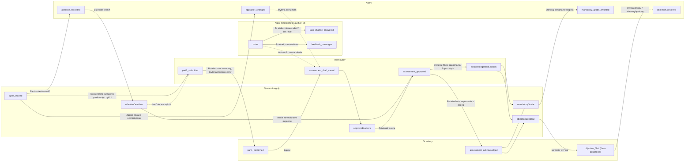

# Event storming: jeden cykl oceny okresowej

Mapa jednego cyklu od początku do stopnia służbowego z mocy prawa. Słowa i nazwy są w `context/domain/glossary.md`. Stan każdej rzeczy wynika ze zdarzeń widocznych przez `visibleEvents(cycleId)` (granica `date <= today()`), a nie z kolumny statusu. Zapis z ekranu dostaje datę `today()`.

Plastry: F-01 `rules-engine-and-demo-data`, S-01 `cycle-start-criteria`, S-02 `assessment-and-confirmation`, S-03 `timeline-and-absences`, S-04 `notes-and-justification`, S-05 `hr-partner-question`, S-06 `hr-overview-and-print`.

## 1. Przebieg

Szkic oceny wymaga widocznego `part1_confirmed`. Notatka to osobna czynność: można ją zapisać przed potwierdzeniem części I i o osobie bez cyklu; do szkicu trafia tylko przez „Wstaw do uzasadnienia”.

## 2. Kanwa

Kolejność w czasie dla Piotra (daty pokazu: 9.12.2024, 11.03.2026, 10.11.2026, 21.11.2026, 22.11.2026). „Dane pokazowe” znaczy: zdarzenie powstaje tylko w `src/seed/`, bez przycisku.

| # | Aktor | Polecenie | Zdarzenie | Reguła albo polityka | Widok | Plaster |
|---|---|---|---|---|---|---|
| 1 | System (dane pokazowe) | zatrudnienie, mianowanie albo poprzednia ocena | `cycle_started { reason, periodStart, previousAssessmentOn, previousAcknowledgedOn, previousOutcome }` | Cykl widoczny od daty zdarzenia (10i). Termin rozmowy o kryteriach: 30 dni od poprzedniej oceny (§ 7 pkt 1), 7 dni po negatywnej (§ 7 pkt 2). | Oceniający: „Wyznacz kryteria oceny: …, do 27.12.2024” (`homeTasks`); kadry: krok `criteria_due` (`cycleState`) | F-01, S-01 |
| 2 | Oceniający | „Zapisz”, `POST /cycles/:id/part1/criteria` | wiersze `cycle_criteria`, `cycles.sheet` (bez zdarzenia) | Arkusz z rodzaju stanowiska (§ 3). Najwyżej 3 dodatkowe, bez powtórzeń i obowiązkowych. Podpowiedzi z tabeli urzędu, nic nie zaznacza się samo. | Oceniający: formularz części I (`part1Status` = `draft`) | S-01 |
| 3 | Oceniający | „Karta rozmowy rozpoczynającej”, `GET /cycles/:id/cards/opening` | — (odczyt) | Cztery tematy z § 5 ust. 1 z pliku reguł. | Karta `card('opening')` | S-01 |
| 4 | Oceniający | „Potwierdzam rozmowę i przekazuję część I”, `POST /cycles/:id/part1/submit` | `part1_submitted { sheet, criteria, dueDate, dueDateBasis, criteriaBasis, rulesVersion, place, appraiserName }` | Jedna transakcja. Data zdarzenia = dzień rozmowy o kryteriach. `dueDate` = migawka `effectiveDeadline(cycleId, { asOf })` na dzień zapisu (`savePart1`); odtąd ekran części I i wydruk części I pokazują `dueDate`. `rulesVersion` to cały obiekt `{ version, effectiveFrom, act }`. Od teraz część I jest zablokowana. | Oceniany: „Potwierdź część I oceny”; oceniający i kadry: „Część I czeka na potwierdzenie od X dni” (`waitingDays`, 10d) | S-01 |
| 5 | Oceniany | „Potwierdzam rozmowę, kryteria i termin oceny”, `POST /cycles/:id/part1/confirm` | `part1_confirmed { place, appraiseeName }` | Tylko `cycles.person_id`, tylko stan `submitted`. Miejscowość z `settings.office_city` (§ 6 ust. 2; potwierdzenie, nie podpis, 11b). | Wszyscy: `ConfirmationBlock`; ocena dostępna | S-01 |
| 6 | Oceniający otwartego cyklu albo przełożony | „Zapisz notatkę”, `POST /people/:personId/notes` (podpowiedź: `POST /suggestions/note`, 200 bez zapisu) | wiersz `notes` z `task_change`, `suggested_task_change`, `suggestion_source` | Pisze `cycles.appraiser_id` cyklu z `openCycle(personId)`; bez otwartego cyklu `supervisor_id` (puste `cycle_id`). Niezależne od części I: możliwe przed jej potwierdzeniem. Zapisuje się wybór człowieka. Adapter dostaje tekst bez nazwisk. | Tylko autor: „Moje notatki” (`notesByAuthor`); oceniany nie widzi notatki (11c) | S-04 |
| 7 | Autor notatki (`notes.author_id`) | „Tak” / „Nie”, `POST /notes/:noteId/task-change` | `task_change_answered { noteId, answer, developmentFormId }` | Tylko autor notatki (inne konto: 403; dawny oceniający zachowuje dostęp do swojej notatki, nowy go nie dostaje). Pytanie tylko przy `task_change = 1` (inaczej 404); druga odpowiedź: 409. Po „Tak”: karta `taskChange`, jedna forma rozwoju, zdanie z art. 81 ust. 6 i § 9 ust. 1–2 (11e). | Oceniający: „Rozmowa po zmianie zadań” | S-05 |
| 8 | Autor notatki (`notes.author_id`) | „Przekaż pracownikowi”, `GET/POST /notes/:id/feedback` | wiersz `feedback_messages` (`sent_on`) | Tylko autor notatki (`noteById(id)`); cudza notatka: 403, notatki nie ma: 404. Wysłany tekst jest poprawioną kopią; notatka zostaje u autora. Data wysłania zeruje przypomnienie o docenianiu (10j). | Oceniany: `GET /feedback`; S-05: `lastFeedbackDate` | S-04 |
| 9 | Kadry | „Zapisz nieobecność”, `POST /cycles/:id/absences` | wiersz `absences` + `absence_recorded { absence_id, notified }` | Tylko daty i „usprawiedliwiona” (10m). Wpisy rozdzielone dniami wolnymi łączą się; dłużej niż miesiąc przedłuża termin (art. 81 ust. 7); dzień roboczy raz, na końcu. | Kadry i oceniający: oś z datami (`buildTimeline`); oceniany: sam termin i podstawa; przed zatwierdzeniem wszyscy: `effectiveDeadline` (30.12.2026); po widocznym `assessment_approved` termin z migawki się nie zmienia. Cykl nieotwarty: 409 | S-03 |
| 10 | Kadry | „Zapisz zmianę oceniającego”, `POST /cycles/:id/appraiser` | `appraiser_changed { from_id, to_id }` + `cycles.appraiser_id` | Jedna transakcja; `cycle_criteria` nietknięte (§ 9 ust. 3). Notatki zostają u autora. Cykl nieotwarty: 409. | Kadry i oceniający: wpis na osi; oceniany go nie widzi | S-03 |
| 11 | Oceniany (dane pokazowe) | — | `due_change_requested { requestedDate, reason }` | Powód z zamkniętej listy art. 81 ust. 8; po zmianie zawiadomienie na piśmie (§ 8, 11d). | Kadry: stan w `/hr` (`cycleState`) | S-06 |
| 12 | System | przesunięcie daty, `POST /demo/date` | — (`settings.demo_date`) | Tylko do przodu. Przypomnienie o terminie oceny w oknie `assessmentReminderDays` (ustawienie urzędu). | Oceniający i oceniany: pozycja listy spraw | F-01, S-03 |
| 13 | Oceniający | „Przed rozmową z pracownikiem”, `GET /cycles/:id/before-meeting`; karta `GET /cycles/:id/cards/assessment-conversation` | — (odczyt) | Granica zmiany zadań = najwcześniejsza notatka z `task_change = 1` bez odpowiedzi „Nie”. Bez liczb przy nazwisku (10k). Tematy z § 10. | `beforeMeetingSummary`, karta `assessment` | S-05, S-04 |
| 14 | Oceniający | „Zapisz”, `POST /cycles/:id/assessment` | `assessment_draft_saved` (`AssessmentDraft`) | Widoczne `part1_confirmed`, etap `draft`, skala 1/3/5/7/9. Wynik liczy `computeAssessment` na serwerze. Ostrzeżenie `recent_only` nie blokuje. | Oceniający: ramka wyniku i notatki przy kryteriach (sloty S-04) | S-02, S-04 |
| 15 | Oceniający | „Zatwierdź ocenę”, `POST /cycles/:id/assessment/approve` | `assessment_approved` (`AssessmentSnapshot`) | `approvalBlockers` puste; jedna transakcja; migawkę składa tylko `buildAssessmentSnapshot(cycleId, draft, { asOf })`: wynik, `deadline` (`effectiveDeadline` z dnia zatwierdzenia, odtąd zamrożony), `grade` i `gradeAwardedOn` z `currentGrade`, `rulesVersion`, potwierdzenie oceniającego. | Oceniany: „Zapoznaj się z oceną”; oceniający: „Czeka na potwierdzenie zapoznania”; kadry: podgląd | S-02 |
| 16a | Oceniany | „Potwierdzam zapoznanie z oceną”, `POST /cycles/:id/assessment/acknowledge` | `assessment_acknowledged { place, date, name, objectionDeadline }` | Tylko `cycles.person_id`, etap `approved`. Termin sprzeciwu liczony raz (art. 83 ust. 1): 22.11.2026 → 30.11.2026. | Oceniany, oceniający, kadry: `ObjectionClock`; kadry: krok `acknowledged` | S-02 |
| 16b | Oceniający | „Stwierdź fikcję zapoznania”, `GET /cycles/:id/assessment/fiction`, potem „Zapisz wpis”, `POST /cycles/:id/assessment/fiction` | `acknowledgement_fiction { reason, deliveryMethod, deliveredOn, objectionDeadline }` | Zamiast 16a, nigdy obok. Ekran skutku (11a), wybór „nie mógł / nie chciał”, sposób i dzień doręczenia kopii (§ 12 ust. 2). Bez automatu (5b). | Kadry: wpis o fikcji; wszyscy: zegar „system liczy” | S-02 |
| 17 | Oceniany (dane pokazowe) | — | `objection_filed { to }` | Rozpatrzenie w 14 dni (art. 83 ust. 3, `objectionReviewDeadline`). | Kadry: „Sprzeciw wniesiony …, rozpatrzenie do …” | S-06 |
| 18 | Kadry | „Uwzględniony: zmiana oceny” / „Uwzględniony: ponowne sporządzenie oceny” / „Nieuwzględniony”, `POST /cycles/:id/objection-outcome` | `objection_resolved { outcome }` | Tylko przy widocznym `objection_filed`, po zamknięciu cyklu (409 „cykl nie jest otwarty” tu nie obowiązuje); powtórzenie → 409; stan uproszczony bez obiegu (decyzja 4). | Kadry: krok `objection_resolved` | S-06 |
| 19 | System | odczyt `/hr` | — (`mandatoryGrade`) | Dwie kolejne oceny pozytywne na dwóch najwyższych poziomach od ostatniego stopnia; 30 dni od zapoznania albo fikcji drugiej, z przejściem na dzień roboczy (art. 89 ust. 2). | Kadry: „Obowiązek urzędu: stopień służbowy z mocy prawa” (Tomasz, do 14.12.2026) | S-06 |
| 20 | Kadry | „Odnotuj przyznanie stopnia”, `POST /hr/grades/:personId` | `mandatory_grade_awarded { personId, fromGrade, toGrade, basis }` | Po zamknięciu cyklu (409 „cykl nie jest otwarty” tu nie obowiązuje). Bez obowiązku albo przy stopniu IX → 409. Zapis przy cyklu drugiej oceny z pary. | S-02 i S-06: nowy stopień z `currentGrade` | S-06 |
| 21 | Oceniany, oceniający, kadry | „Drukuj / pobierz PDF”, „Drukuj część I”, `GET /cycles/:id/sheet` | — (odczyt) | `canViewSheet`; termin: część I z `dueDate`, otwarty cykl z `effectiveDeadline`, ocena zatwierdzona z `AssessmentSnapshot.deadline`; bez notatek i informacji zwrotnych; „Potwierdzenie w systemie” zamiast „podpis”; pouczenie o sprzeciwie zawsze. | `sheetData`, `assessmentHistory` (`GET /people/:id/history`) | S-06 |

## 3. Reguły biznesowe

Format: reguła · podstawa · plaster · gdzie pilnowana · test w planie właściciela.

1. **Arkusz wynika z rodzaju stanowiska:** `head_of_office` → A, `manager` → B, `staff` → C. · § 3 ust. 2–4 · S-01 · czysta funkcja `sheetForPosition` · `src/engine/criteria.test.ts`.
2. **Najwyżej 3 kryteria dodatkowe, bez powtórzeń i bez obowiązkowych danego arkusza.** · rozporządzenie (limit w pliku reguł) · S-01 (funkcja z F-01) · `validateAdditionalCriteria` + trasa (422) · `src/cycles/part1.test.ts`, `src/routes/cycle-start.test.tsx` (4 dodatkowe → 422).
3. **Termin rozmowy o kryteriach: 30 dni, a po ocenie negatywnej 7 dni.** · § 7 pkt 1–2 · S-01, S-06 · `criteriaTalkDeadline` · `src/cycles/part1.test.ts`, `src/hr/cycle-state.test.ts`.
4. **Ocena nie powstaje bez potwierdzonej części I.** · PRD Business Logic · S-02 · trasy zapisu (409) i widok bez formularza · `src/routes/assessment.test.ts` (bez `part1_confirmed` → 409).
5. **Po przekazaniu kryteria i termin w części I są zablokowane.** · § 6 ust. 2, PRD US-02 · S-01 · `isPart1Locked` + trasa (409) · `src/routes/cycle-start.test.tsx` (`POST …/criteria` po przekazaniu → 409). S-01 blokuje już od przekazania, PRD mówi „po potwierdzeniu”. Część I pokazuje odtąd `dueDate`; bieżący termin cyklu (`effectiveDeadline`) zmienia przed zatwierdzeniem oceny tylko nieobecność.
6. **Wynik: ocena negatywna, gdy średnia nie przekracza 4 albo choć jedna ocena cząstkowa to 1; bez zaokrąglania.** · § 11 ust. 1 · F-01 (silnik), S-02 · czysta funkcja `computeAssessment` · `src/engine/scoring.test.ts`, `src/engine/approval.test.ts` (średnia równa 4, „1” przy średniej powyżej 4).
7. **Uzasadnienie wymagane przy ocenie negatywnej.** · § 11 ust. 3 · S-02 · `approvalBlockers` (czysta) + trasa `approve` (422) · `src/engine/approval.test.ts`, `src/routes/assessment.test.ts`.
8. **Wnioski do indywidualnego programu rozwoju zawodowego są zawsze wymagane.** · art. 81 ust. 5 ustawy · S-02 · `approvalBlockers` + trasa (422) · `src/routes/assessment.test.ts` (zatwierdzenie bez wniosków → 422).
9. **Wniosek o stopień tylko dla urzędnika mianowanego z oceną pozytywną, poniżej stopnia IX, z umotywowaniem.** · § 11 ust. 5, art. 89 ust. 1 ustawy · S-02 · `approvalBlockers`, `gradeRequestOptions` + trasa (422) · „Test wniosku o stopień” w `src/routes/assessment.test.ts` (cykl Tomasza, 2026-11-10).
10. **Ocenę zatwierdza tylko oceniający cyklu, raz.** · decyzja 5a · S-02 · trasa w transakcji (403, 409) · `src/routes/assessment.test.ts` (dwa `approve` → jedno `assessment_approved`).
11. **Z pary zapoznanie i fikcja zapisuje się dokładnie jedno zdarzenie; pierwsze zamyka etap.** · decyzje 5b, 10n · S-02 · trasy w jednej transakcji SQLite · `src/routes/assessment.test.ts` (`Promise.all` → jedno zdarzenie; potwierdzenie po fikcji → 409).
12. **Fikcja wymaga powodu „nie mógł / nie chciał” oraz sposobu i dnia doręczenia kopii arkusza; nie wpisuje się sama.** · § 12 ust. 2, decyzje 5b, 11a · S-02 · trasa `fiction` (422) · `src/routes/assessment.test.ts` (faza 2).
13. **7 dni na sprzeciw liczone raz, od dnia zdarzenia zapoznania albo fikcji, z przejściem na dzień roboczy; potem czytane z payloadu.** · art. 83 ust. 1 ustawy · S-02 · `objectionDeadline` przy zapisie, `assessmentState` czyta payload · `src/assessment/state.test.ts` (payload różny od silnika), testy zegara w `src/routes/assessment.test.ts` (22.11 → 30.11.2026).
14. **Nieobecności rozdzielone samymi dniami wolnymi łączą się w jedną; nieusprawiedliwiona przerywa ciągłość.** · art. 81 ust. 7 ustawy, zasady liczenia terminów KPRM · S-03 · czysta funkcja `mergeAbsences` · `src/engine/absences.test.ts`.
15. **Usprawiedliwiona nieobecność dłuższa niż miesiąc przedłuża termin oceny o swój czas; nie przedłuża ponownej oceny po negatywnej.** · art. 81 ust. 7 i 9 ustawy · S-03 · `isLongerThanMonth`, `assessmentDeadline`, `effectiveDeadline` · `src/engine/absences.test.ts` (05.10–06.11.2026 → 30.12.2026; cykl `after_negative`).
16. **Termin kończący się w dzień wolny przechodzi na następny dzień roboczy, raz, po doliczeniu przedłużenia.** · art. 115 Kodeksu cywilnego · F-01, S-03 · `toWorkingDay`, `nextAssessmentDeadline` · `src/engine/absences.test.ts` (14.03.2024 → 2026-04-16).
17. **Terminu oceny nie zapisuje się w `cycles`; ekran bierze go z jednego z trzech źródeł.** Termin przekazany w części I: `part1_submitted.payload.dueDate`; cykl przed zatwierdzeniem oceny: `effectiveDeadline(cycleId)`; po widocznym `assessment_approved`: `AssessmentSnapshot.deadline` (zamrożony, późniejsza nieobecność go nie zmienia). · kontrakt F-01, „Skąd ekran bierze termin oceny” · F-01, S-01, S-02, S-03, S-06 · `effectiveDeadline` w `src/cycles.ts`, `buildAssessmentSnapshot` · `src/routes/absences.test.ts` (ten sam 30.12.2026 przez `effectiveDeadline`, na `/hr` i osi; wydruk zatwierdzonej oceny z migawki bez zmiany po późniejszej nieobecności), `src/routes/sheet.test.ts` (termin z `AssessmentSnapshot.deadline`), `src/cycles/part1.test.ts` (`dueDate` = `effectiveDeadline(cycleId).date` w dniu przekazania).
18. **Nieobecność ma tylko daty i „usprawiedliwiona”, bez rodzaju.** · decyzja 10m, art. 81 ust. 7 · S-03 · schemat tabeli `absences` i formularz · `src/routes/absences.test.ts` (brak kolumny rodzaju w `PRAGMA table_info`, formularz bez pola, `type=urlop` nie trafia do wiersza ani payloadu).
19. **Zmiana oceniającego zostawia kryteria.** · § 9 ust. 3 · S-03 · trasa w transakcji, `cycle_criteria` nietknięte · `src/routes/appraiser.test.ts` (te same wiersze `cycle_criteria`, nowy `appraiser_id`, 303).
20. **Stopień z mocy prawa: dwie kolejne oceny pozytywne na dwóch najwyższych poziomach od ostatniego stopnia, 30 dni od zapoznania albo fikcji drugiej.** · art. 89 ust. 2 ustawy · S-06 · czysta funkcja `mandatoryGrade`, `mandatoryGradeDeadline` · `src/engine/grades.test.ts`.
21. **Zdarzenia wgrane z datą z przyszłości są widoczne dopiero, gdy data systemowa je minie; data systemowa idzie tylko do przodu.** · decyzja 10i · F-01 i każdy plaster · `visibleEvents`, odczyty `notes` i `absences`, `POST /demo/date` · F-01: „osobny test” `src/events.test.ts`; poza tym `src/notes/repo.test.ts` (R1), `src/hr/cycle-state.test.ts`, `src/routes/absences.test.ts`.
22. **Nic nie zapisuje się bez kliknięcia człowieka; podpowiedź tylko zaznacza pole.** · AGENTS.md zasada 7, decyzja 10f · S-02, S-04, S-05 · trasy `POST` zapisują, `GET` i skrypty nie · `src/routes/notes.test.ts` (R6), `src/notes/insert-notes.dom.test.ts` (R12), `src/routes/hr-partner.test.ts` (GET nie dodaje wiersza).
23. **Przy nazwisku pracownika nie ma liczby, wyniku ani etykiety.** · AGENTS.md zasada 7, decyzje 3, 10k · S-02, S-03, S-04, S-05, S-06 · widoki · `src/routes/hr-partner.test.ts` (lista zakazana), `src/routes/hr.test.ts` (brak nazw poziomów i słów „pozytywna/negatywna”), `src/routes/assessment.test.ts` (test etykiet S-02), `src/routes/notes.test.ts` (R16), `src/routes/timeline.test.ts` i `src/routes/absences.test.ts` (zasada 7 na osi i formularzu nieobecności).
24. **Notatkę widzi i obsługuje tylko jej autor (`notes.author_id`), także po zmianie oceniającego: dawny oceniający zachowuje dostęp do swojej notatki, nowy go nie dostaje.** Dotyczy też odpowiedzi na pytanie o zmianę zadań i wysłania informacji zwrotnej. · decyzja 11c, PRD Access Control · S-04, S-05 · `src/notes/repo.ts` (`noteById`), trasy: cudza notatka 403, notatki nie ma 404 · `src/routes/notes.test.ts` (R7, R8: `GET` i `POST /notes/:id/feedback` cudzej notatki → 403), `src/routes/hr-partner.test.ts` (inne konto → 403).
25. **Model nigdy nie proponuje punktów, nie pisze o pracowniku, nie oznacza notatki „dobrze / do poprawy” i nie porównuje pracowników.** · AGENTS.md zasada 5, decyzja 9 · S-04, S-05 · kształt typu `NoteSuggestion` (bez pól na punkty, ocenę, tekst) i adapter `src/suggestions/index.ts` · `src/suggestions/index.test.ts` (R5, bez nazwisk), `src/suggestions/local-model.test.ts` (R15), `src/routes/admin.test.ts` (lista czterech zakazów); samego zakazu nie sprawdza żaden test zachowania.
26. **Słowo „podpis” nie pada w żadnym HTML.** · decyzje 5a, 11b · S-01, S-02, S-06 · widoki, wspólny `ConfirmationBlock` (warianty `confirmation` i `fiction`) · `src/routes/cycle-start.test.tsx`, `src/routes/assessment.test.ts` (ekran skutku), `src/routes/sheet.test.ts`.
27. **Kody odpowiedzi tras.** 303 po `POST`, który zapisuje; 200 po `POST`, który nic nie zapisuje (`POST /suggestions/note`, `POST /cycles/:id/assessment/preview`); 422 przy walidacji (nigdy 400); 403 brak uprawnień; 404 brak zasobu; 409 powtórzenie zamkniętego kroku. 409 za cykl, który nie jest już otwarty, dotyczy tylko części I, oceny, nieobecności i zmiany oceniającego; rozpatrzenie sprzeciwu i odnotowanie przyznania stopnia następują po zamknięciu cyklu. · kontrakt F-01, „Zasady wspólne tras” · każdy plaster · trasy · testy tras każdego plastra.

## 4. Miejsca niepewne

1. **Część I nigdy niepotwierdzona.** Nie ma wyjścia (luka z decyzji 5a). Dziś: oceniający i kadry widzą „Część I czeka na potwierdzenie od X dni”; zdanie dla jury: „Tryb na brak potwierdzenia ustala urząd, system go nie przesądza” (10d).
2. **Moc prawna fikcji zapoznania.** Ustawa i rozporządzenie jej nie znają. Dziś: wpis oceniającego z powodem i doręczeniem kopii, ekran mówi „system liczy”, kadry tylko widzą (5b, 11a). Pytanie do mentorów nr 4: kto stwierdza i co musi być zapisane.
3. **Potwierdzenie zamiast podpisu.** Prawo wymaga pisma i podpisu (art. 81 ust. 3, § 6 ust. 2). Dziś: potwierdzenie w systemie, wydruk z podpisem daje moc prawną (11b). Pytanie do mentorów nr 1.
4. **Kto ustala przechowywanie i usuwanie notatek.** Dokumenty tego nie rozstrzygają: decisions.md nie ma decyzji o okresie przechowywania. Dziś: notatek nie da się edytować ani usunąć (S-04), usunięcie danych i eksport na wniosek są poza prototypem (decyzja 4, PRD Access Control).
5. **Zmiana zadań a zmiana stanowiska.** System nie rozstrzyga, czy to zmiana stanowiska (art. 81 ust. 6). Dziś: karta mówi „Sprawdź terminy z kadrami” (11e); pole „Od kiedy obowiązuje zmiana” nie powstaje (S-05).
6. **Notatki po zmianie oceniającego.** Nowy oceniający nie widzi notatek poprzedniego, więc przy ocenie ma tylko własne. Dziś: tak zostaje (S-04, S-03); pokaz tego nie używa.
7. **Uzasadnienie złożone z notatek.** Nie wiadomo, czy organizator uzna to za wsparcie w formułowaniu oceny (pytanie do mentorów nr 3). Dziś: „Wstaw” bez automatu, tekst do poprawy (10f).
8. **„Na jednym z dwóch najwyższych poziomów”.** Obie oceny na tym samym poziomie czy każda na którymkolwiek z dwóch? Dziś: każda na którymkolwiek (S-06, pytanie 1); termin w sobotę przechodzi na poniedziałek (pytanie 2).
9. **Zmiana terminu przez oceniającego.** Tylko zdanie na ekranie kadr z art. 81 ust. 8 i § 8 (11d); brak zdarzenia i formularza.
10. **Po fikcji oceniany nie może już potwierdzić; przekazania części I nie da się cofnąć.** Wartości domyślne planów S-02 (pytanie 2) i S-01 (pytanie 1), bez decyzji autora.
11. **Cele (temat 4 z § 5 ust. 1).** Bez osobnego pola; cele wpisuje się w oczekiwaniach (S-01, pytanie 3).
12. **Maria „bez cyklu”.** Rozstrzygnięte w kontrakcie: Maria nie ma żadnego cyklu, a przykład sprzeciwu w danych S-06 jest na Katarzynie Lewandowskiej. Cykl osoby zawsze z `openCycle(personId)`.

Pełna tablica warsztatu (192 kartki, w tym 50 miejsc niepewnych z priorytetem, właścicielem i następnym krokiem) jest w `context/domain/event-storming.board.json`.
